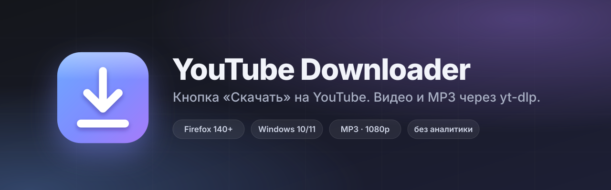
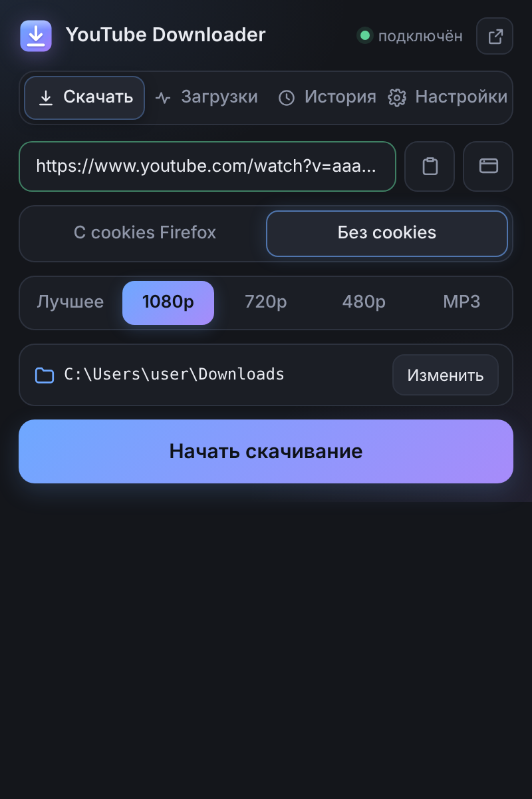
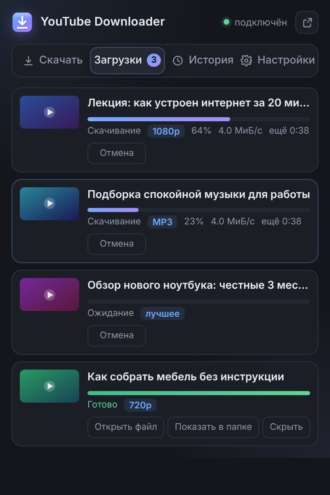
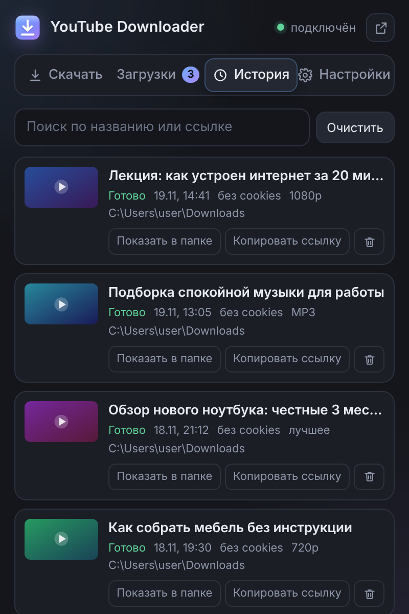
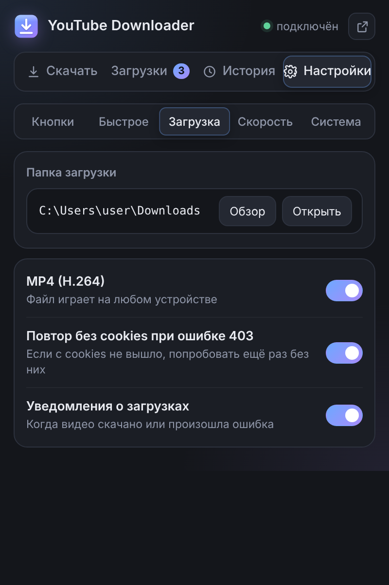
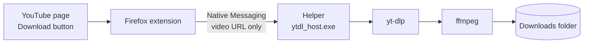

<b><a href="README.md">Русский</a></b> · English

# YouTube Downloader for Firefox

A Firefox extension that adds a **Download** button to YouTube. Video or MP3 lands in your Downloads folder. The heavy lifting is done by [yt-dlp](https://github.com/yt-dlp/yt-dlp) on your own computer: no third-party servers, no ads, no analytics.

  
  
  
  

> The UI is currently in Russian only.

## Install (Windows 10/11, Firefox 140+)

The extension needs a small **companion app** (a Native Messaging host) that launches yt-dlp.

1. `winget install yt-dlp.yt-dlp`, `winget install Gyan.FFmpeg` (for MP3), `winget install OpenJS.NodeJS.LTS`. Reopen PowerShell.
2. Download `youtube-downloader-helper-vX.Y.Z-windows.zip` from [Releases](https://github.com/Null1x/youtube-downloader-firefox/releases/latest), extract it and run `powershell -ExecutionPolicy Bypass -File .\install\install.ps1`.
3. Install the extension from [Firefox Add-ons](https://addons.mozilla.org/firefox/addon/LINK-AFTER-PUBLISHING/) or from the `.xpi` in Releases. Restart Firefox.

## Features

Button on video, Shorts and playlist pages with live progress · `Alt+Shift+D` quick download · best / 1080p / 720p / 480p / MP3 · playlist picker and chapters compilation · queue · searchable history · optional Firefox cookies with automatic retry on HTTP 403.

## How it works

The extension makes no network requests of its own and collects no data, see [PRIVACY.md](PRIVACY.md). Download only content you have the right to and follow the terms of the services and the laws of your country.

## Development

Layout: `extension/` (no build step), `host/ytdl_host.py` (Python 3.9+, stdlib only), `install/` (PowerShell scripts), `dev-tests/`, `docs/`. Details in [docs/INSTALL.md](docs/INSTALL.md) (Russian). Tagging `vX.Y.Z` builds the release via GitHub Actions.

## License

[MIT](LICENSE). yt-dlp and ffmpeg have their own licenses and are not part of this repository.
