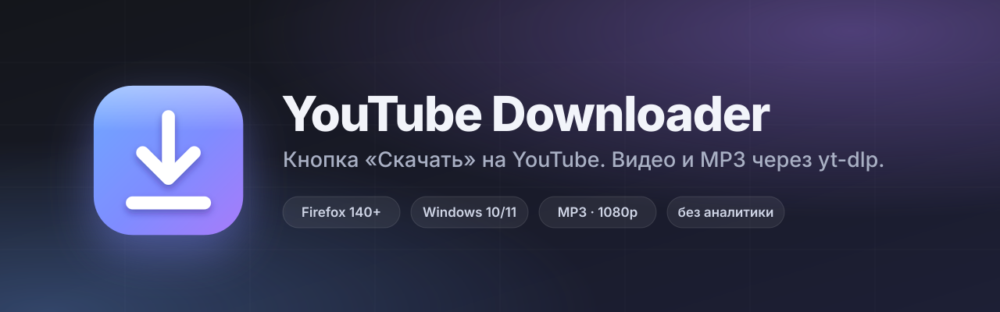
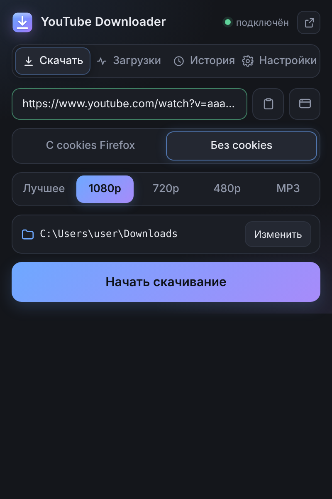
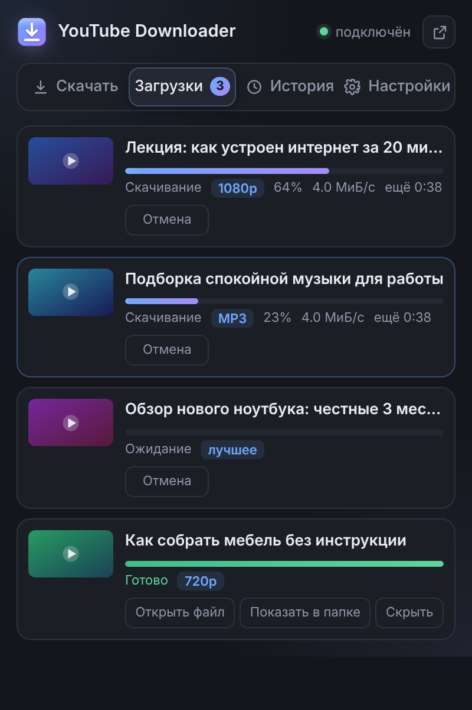
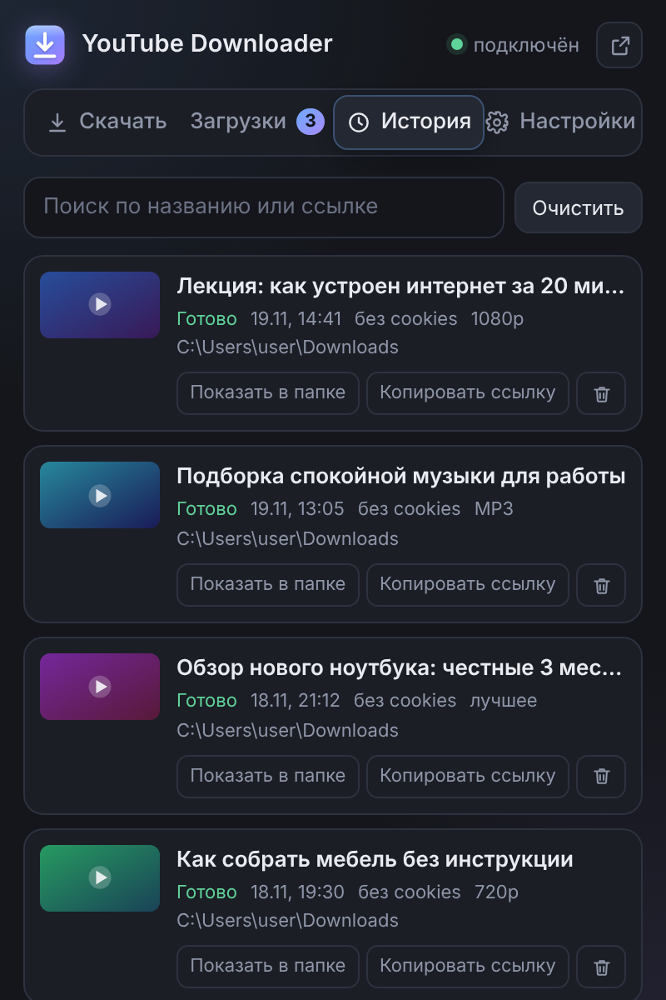
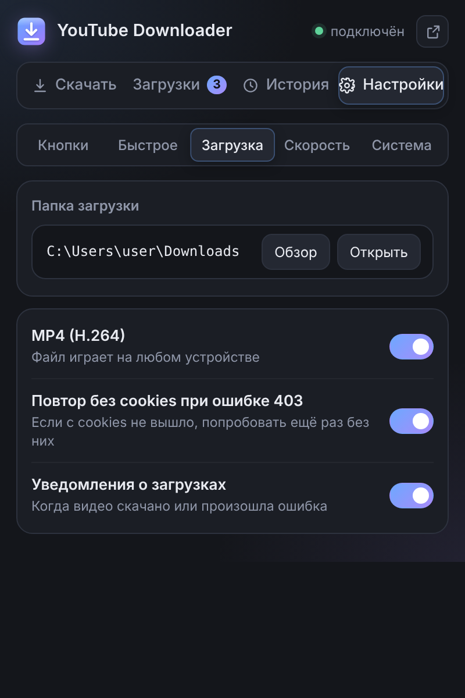
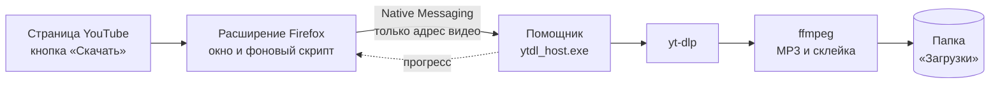

<p align="center">
  
</p>

<p align="center">
  <a href="https://github.com/Null1x/youtube-downloader-firefox/releases/latest"></a>
  <a href="LICENSE"></a>
  
  
  
  
</p>

<p align="center">
  <b><a href="#-установка">Установка</a></b> ·
  <b><a href="#-возможности">Возможности</a></b> ·
  <b><a href="#-как-это-устроено">Как устроено</a></b> ·
  <b><a href="#-частые-вопросы">Вопросы</a></b> ·
  <b><a href="#-для-разработчиков">Разработка</a></b> ·
  <b><a href="README.en.md">English</a></b>
</p>

---

## ✨ Что это

Расширение для Firefox, которое добавляет на YouTube кнопку **«Скачать»**. Нажал, и видео или MP3 оказывается в папке «Загрузки». Всю работу делает [yt-dlp](https://github.com/yt-dlp/yt-dlp) на твоём компьютере: никаких сторонних серверов, рекламы и аналитики.

<table>
  <tr>
    <td align="center"><br><sub><b>Скачать</b><br>ссылка, качество, MP3</sub></td>
    <td align="center"><br><sub><b>Загрузки</b><br>прогресс и готовые файлы</sub></td>
    <td align="center"><br><sub><b>История</b><br>папка, ссылка, удалить</sub></td>
    <td align="center"><br><sub><b>Настройки</b><br>папка, MP4, скорость</sub></td>
  </tr>
</table>

## 🚀 Установка

> [!IMPORTANT]
> Расширению нужна небольшая **программа-помощник** (по-английски Native Messaging host). Браузер сам не умеет запускать yt-dlp, поэтому помощник делает это за него. Ставится один раз.

**1. Поставь yt-dlp, ffmpeg и Node.js** (PowerShell):

```powershell
winget install yt-dlp.yt-dlp
winget install Gyan.FFmpeg          # нужен для MP3 и для склейки видео со звуком
winget install OpenJS.NodeJS.LTS    # движок JavaScript для yt-dlp
```

Потом закрой PowerShell и открой заново.

**2. Установи помощника.** Скачай `youtube-downloader-helper-vX.Y.Z-windows.zip` со страницы [Releases](https://github.com/Null1x/youtube-downloader-firefox/releases/latest), распакуй куда угодно и выполни:

```powershell
powershell -ExecutionPolicy Bypass -File .\install\install.ps1
```

Помощник копируется в `%LOCALAPPDATA%\YouTubeDownloader`, права администратора не нужны. Распакованную папку после этого можно удалить.

**3. Установи расширение** и перезапусти Firefox:

- со страницы **[Firefox Add-ons](https://addons.mozilla.org/firefox/addon/ССЫЛКА-ПОСЛЕ-ПУБЛИКАЦИИ/)** (после публикации в магазине), или
- файлом `.xpi` со страницы Releases: `about:addons` → шестерёнка → «Установить дополнение из файла».

**4. Проверь.** Открой любое видео на YouTube, рядом с кнопками «Поделиться» появится «Скачать». Нажми на значок расширения: внизу должно быть «подключён».

Нет подключения или что-то не работает? Смотри [частые вопросы](#-частые-вопросы). Установка из исходников и подпись своей сборки: [docs/INSTALL.md](docs/INSTALL.md).

## 🎯 Возможности

| | |
|---|---|
| **Кнопка на странице** | На видео, в Shorts и на странице плейлиста. В полноэкранном режиме её нет, чтобы не мешала. |
| **Живой прогресс** | Кнопка сама показывает «Скачиваю 45%», потом «Скачано». Итог приходит и уведомлением. |
| **Горячая клавиша** | `Alt+Shift+D` скачивает текущее видео сразу, без окон. Меняется в `about:addons`. |
| **Качество** | Лучшее, 1080p, 720p, 480p или **MP3** (лучшее качество, название и автор в тегах). |
| **Плейлисты** | Выбор роликов галочками, отдельные файлы или один сборник с главами. |
| **Очередь** | Вставь сколько угодно ссылок, они качаются по очереди (1–4 одновременно). |
| **История** | Поиск, «Показать в папке», «Копировать ссылку», удаление. |
| **Cookies Firefox** | По желанию, для видео с ограничениями. При ошибке 403 помощник сам повторяет без cookies. |
| **Понятные ошибки** | Не «код 1», а что случилось и что делать. Например, «Для MP3 нужен ffmpeg». |
| **Лёгкий** | Страница YouTube проверяется редко, закрытое окно не получает поток сообщений о прогрессе. |

## 🧩 Как это устроено



- **Расширение** ничего не скачивает и не ходит в сеть. Оно только показывает интерфейс и передаёт помощнику адрес видео.
- **Помощник** проверяет адрес (только `youtube.com` и `youtu.be`), запускает yt-dlp без `shell=True` и присылает прогресс.
- **Cookies** остаются в Firefox, помощник их не читает и не сохраняет.
- Настройки, история и лог лежат в `%APPDATA%\YouTubeDownloader\` (`settings.json`, `history.json`, `host.log`).

## ❓ Частые вопросы

<details>
<summary><b>Внизу написано «помощник не подключён»</b></summary>

1. Выполни `install\install.ps1` и **перезапусти Firefox** (не просто закрой окно: должен завершиться процесс).
2. Проверь, что файл `%LOCALAPPDATA%\YouTubeDownloader\ytdl_host.json` существует.
3. Если ставил расширение из своего `.xpi` с другим ID, добавь этот ID в `allowed_extensions` в `install\install.ps1` и запусти скрипт снова.
4. Смотри `%APPDATA%\YouTubeDownloader\host.log`.
</details>

<details>
<summary><b>MP3 не скачивается или появляется непонятный файл</b></summary>

Нужен ffmpeg: `winget install Gyan.FFmpeg`, затем закрой и открой Firefox. Путь можно указать вручную в «Настройки → Система». Без ffmpeg MP3 не начнёт скачиваться, а в окне будет красная подсказка.
</details>

<details>
<summary><b>Ошибка 403 или «Sign in to confirm you're not a bot»</b></summary>

Включи «С cookies Firefox» (нужно быть залогиненным в YouTube в этом Firefox). Обнови yt-dlp: «Настройки → Система → Обновить». Включена ли автоповторная попытка без cookies, смотри в «Настройки → Загрузка».
</details>

<details>
<summary><b>Кнопки «Скачать» нет на странице</b></summary>

Включи кнопку в «Настройки → Кнопки». Если YouTube сменил вёрстку и нужное место не найдено, через пару секунд появится плавающая кнопка в углу (в полноэкранном режиме её нет).
</details>

<details>
<summary><b>Работает ли на Linux и macOS?</b></summary>

Сейчас нет: установщик и сборка помощника написаны под Windows. Код помощника — обычный Python (`host/ytdl_host.py`), его можно адаптировать. Пул-реквесты приветствуются.
</details>

<details>
<summary><b>Как удалить?</b></summary>

`install\uninstall.ps1`, затем удали расширение в `about:addons`. Настройки и история остаются в `%APPDATA%\YouTubeDownloader` (папку можно удалить вручную).
</details>

## 🛠 Для разработчиков

```text
youtube-downloader-firefox/
├── extension/          расширение Firefox (без сборки, обычные файлы)
│   ├── manifest.json
│   ├── background.js   фон: связь с помощником, уведомления, итог на странице
│   ├── content/        кнопка на YouTube
│   ├── ui/             окно расширения (html, css, js)
│   └── icons/
├── host/
│   └── ytdl_host.py    помощник (Python 3.9+, без внешних зависимостей)
├── install/            PowerShell: сборка, установка, подпись, удаление
├── dev-tests/          тесты помощника, фона, окна и кнопки (Playwright)
├── docs/               установка, тексты для магазина, скриншоты
├── .github/            автосборка релиза и проверка расширения
├── CHANGELOG.md
├── PRIVACY.md
└── LICENSE
```

**Запуск из исходников:** [docs/INSTALL.md](docs/INSTALL.md). В `about:debugging#/runtime/this-firefox` нажми «Загрузить временное дополнение» и выбери `extension/manifest.json`.

**Сборка помощника:** `powershell -ExecutionPolicy Bypass -File .\install\build.ps1` (Python 3.9+ и PyInstaller).

**Тесты:** подготовка и запуск описаны в [dev-tests/README.md](dev-tests/README.md). Нужны Python, Node.js, Playwright с Chromium.

**Релиз:** подними `version` в `extension/manifest.json` и `CHANGELOG.md`, затем:

```bash
git commit -am "Релиз 1.7.2"
git tag v1.7.2
git push && git push --tags
```

Workflow [`release.yml`](.github/workflows/release.yml) соберёт `ytdl_host.exe` на Windows и приложит к релизу архив помощника и архив расширения для загрузки в AMO.

**Публикация в Firefox Add-ons:** тексты и заметки для ревьюера в [docs/STORE_LISTING.md](docs/STORE_LISTING.md).

## 🔒 Приватность

Расширение не собирает и не отправляет никаких данных. Подробности: [PRIVACY.md](PRIVACY.md).

## ⚖️ Ответственность

Скачивайте только то, на что у вас есть право: свои видео, материалы с разрешающими лицензиями, личные копии там, где это законно. Соблюдайте условия сервисов и законы своей страны. Автор не отвечает за то, как вы используете программу.

## 🙏 Спасибо

- [yt-dlp](https://github.com/yt-dlp/yt-dlp): вся магия скачивания
- [FFmpeg](https://ffmpeg.org/): MP3 и склейка
- [Shields.io](https://shields.io/): значки в этом README

## 📄 Лицензия

[MIT](LICENSE). Сам yt-dlp и ffmpeg распространяются под своими лицензиями и в этот репозиторий не входят.
